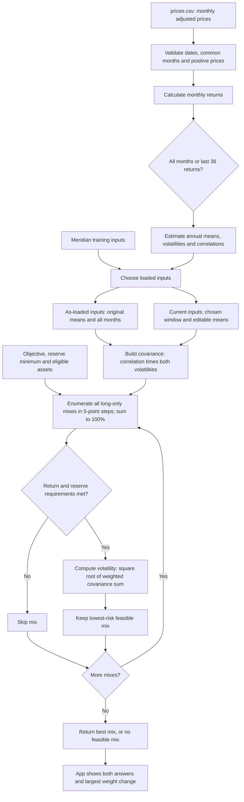

# Lab 15 — Portfolio stability decision

Stefan Herning | October 22, 2026 | Lab activities completed and student-confirmed; GitHub publication and checkout pending.

## Own mandate

Student selected this AI-proposed fictional classroom case: university club reserve, five-year horizon, 5% annual nominal expected-return objective, at least 20% in Treasury-bill funds. Search minimizes annualized volatility among long-only, fully invested five-percentage-point allocations. Only BIL counts toward this client's reserve rule; IEF is not a Treasury-bill fund. Meridian separately counts bills and the 10-year note as instructed.

The 5% target is not inflation-adjusted or guaranteed, and no separate transaction/tax/advisory-cost model is supplied. Client question to resolve: how much must be available for club spending, and when? The reserve floor alone does not specify a dollar withdrawal schedule or maximum tolerable loss.

## Fund universe and sources

The following lab example funds were proposed by AI for the student-selected roles and used by the student in the app runs shown in their screenshots.

| Ticker | Fund | Role | Price source | Download date |
| --- | --- | --- | --- | --- |
| BIL | State Street SPDR Bloomberg 1-3 Month T-Bill ETF | Treasury-bill reserve | https://finance.yahoo.com/quote/BIL/history/ | 2026-10-22 |
| IEF | iShares 7-10 Year Treasury Bond ETF | Government bonds | https://finance.yahoo.com/quote/IEF/history/ | 2026-10-22 |
| LQD | iShares iBoxx $ Investment Grade Corporate Bond ETF | Corporate bonds | https://finance.yahoo.com/quote/LQD/history/ | 2026-10-22 |
| VT | Vanguard Total World Stock ETF | Global equity | https://finance.yahoo.com/quote/VT/history/ | 2026-10-22 |

## Data and estimation

prices.csv uses Yahoo Finance chart API `indicators.adjclose`, monthly frequency. 61 prices cover September 2021 through September 2026, producing 60 monthly returns. The unfinished October 2026 month is excluded. Yahoo labels monthly bars at the start of the month; the CSV uses calendar month-end labels for the corresponding monthly closing observation, not a claim that exchanges traded on that calendar day. No forward fill, interpolation, winsorization or replacement with unadjusted Close. All funds have the same complete monthly calendar.

Monthly return = current adjusted price / prior adjusted price - 1. Annual expected-return estimate = arithmetic monthly mean × 12; annual volatility = sample monthly standard deviation × sqrt(12); correlations use the same paired monthly returns. Last 36 uses 37 prices for exactly 36 returns, October 2023-September 2026. Annual scaling assumes independent months. Historical estimates are not forecasts. Downloaded adjusted histories can be revised later; source responses and hashes preserve this snapshot.

## Meridian validation

| Run | Bills / 10-year / IG / equity (%) | Return (%) | Volatility (%) |
| --- | --- | --- | --- |
| As loaded | 0 / 20 / 25 / 55 | 6.51 | 9.44 |
| Equity return 8 to 7 | 0 / 10 / 10 / 80 | 6.53 | 12.94 |
| IG-equity correlation 0.50; original returns | 0 / 40 / 0 / 60 | 6.52 | 9.73 |

Largest weight change for the equity stress is 25 percentage points. Original Lab 14 printed output is byte-for-byte unchanged. Six engine tests pass, including bad data, full grid enumeration, annualization and infeasibility. Streamlit AppTest verifies rendered base/stress metrics and infeasible messages. Automated tests were AI-executed. The student subsequently confirmed the base and equity-stress runs and supplied screenshots matching the equity stress and the actual engine-correlation edit. The saved engine was checked after the exercise: both IG-equity correlation entries are restored to 0.25.

## Own universe — student app comparison

Both runs use a 5% objective and a 20% BIL minimum; no objective lowering.

| Window | BIL / IEF / LQD / VT (%) | Expected return (%) | Volatility (%) | Reserve (%) |
| --- | --- | --- | --- | --- |
| All 60 returns | 80 / 0 / 0 / 20 | 5.25 | 3.09 | 80 |
| Last 36 returns | 95 / 0 / 0 / 5 | 5.16 | 0.65 | 95 |

Largest weight change is 15 percentage points. These are different historical estimation windows; the recent-window risk figure is not a forecast or loss guarantee. CSV source evidence and raw results are preserved. The student supplied screenshots reproducing both allocations with the unchanged 5% objective and 20% reserve floor.

## Engine flowchart

AI-generated after the student confirmed completing the separate paper diagram. Compare this with the original drawing; this is not a recreation of the AI-off artifact.

The same search function evaluates the as-loaded and current branches separately. The baseline always uses all months; both branches share the current objective, reserve floor and eligible assets. Current-window return edits reset when the window changes.

## Estimate attack and interpretation

The student identifies **Will Gao** as the partner who challenged VT's 36-month historical annualized mean of about 20.25%, proposing a judgment-based forward stress range of 6.5%-7.5% and entering **7.00%**. This range is a scenario assumption, not a verified forecast. Partner identity and role were confirmed by the student; the exchange was not independently witnessed by Codex.

With the 36-month window retained, the screenshot shows **75% BIL / 25% VT**, expected return **5.02%**, volatility **2.96%**, reserves **75%**. The change from the pre-attack 36-month allocation (95% BIL / 5% VT) is **20 percentage points**. The screen's **5-point** indicator instead compares to the all-month 80/20 baseline. The earlier window-only comparison was **15 points**.

Student's approved response and decision (AI-edited for numerical accuracy):

> Replacing VT’s noisy historical estimate with 7% moved the allocation 20 percentage points, showing substantial sensitivity to expected returns. I reject 95/5 and would pilot 75/25 for further testing only; it is not ready for adoption because it misses the 5% target at the lower end of my proposed return range.

Adoption condition proposed by the student: retain a 5% expected return across VT assumptions of roughly 6.5%-7.5%, and test both covariance windows. The condition is **not met**: holding the recent BIL estimate near 4.37%, fixed 75/25 returns about **4.90%** at a 6.5% VT estimate. Covariance changes fixed-mix volatility, not its expected return. Substituting all-month means as well would be a separate change. The 95/5 mix requires VT near **17.05%** to meet 5%, holding the recent BIL mean fixed.

The student's initial draft cited a nine-point standard error and a 15-point attack movement. AI checked and corrected these before approval: the simple independent-month approximation gives about **6.76 percentage points** for the annualized 36-month VT mean's standard error; attack movement is **20 points**. Neither estimate precision nor low historical volatility establishes future safety.

## Partner code question

Partner: **Will Gao**, also identified by the student as the partner for the VT estimate attack.

Question: Why use a 5-point grid instead of a continuous optimizer?

Student answer:

> Four assets in 5-point steps make only 1,771 possible allocations, so the search can check every one exactly against the long-only, sum-to-100%, objective, and reserve constraints. That makes the result transparent and reproducible. The cost is that the chosen allocation can be up to one grid step away from the true continuous minimum-risk portfolio, which the app’s footnote discloses.

AI correction supplied after this answer: the first two sentences are correct, but the final sentence claims an unsupported error bound. There is **no guarantee** that the selected grid allocation is within five percentage points of the continuous optimum. The search minimizes risk only over feasible grid points; it can miss better continuous allocations or feasible allocations between grid points. The app footnote discloses the grid limitation, not a one-step error guarantee. The number of four-asset grid allocations is C(23,3) = 1,771.

## Student confirmation of remaining activities

The student confirms completing the paper diagram without AI and that the Mermaid chart matches it. The student also confirms explaining the mandate and universe to Will Gao, explaining the search code without AI, swapping roles for the exercises, and discussing estimation risk and the final decision. These are student attestations, not activities independently witnessed by Codex. The specific code question, original answer, AI correction, estimate attack and approved decision are recorded above.

GitHub publication and Brightspace checkout remain pending.

## AI use and limitations

Codex built the search and estimator, installed Streamlit in an isolated environment, created app.py importing the engine, fetched/checked prices, ran tests and drafted this record. The student selected the client mandate. No partner activity or personal judgment is fabricated. The five-point grid is coarse and can miss a feasible continuous solution; an infeasible result means no feasible allocation on this grid. App handles the specified return objective and reserve floor, not every possible client restriction. Do not use Meridian's holdings checker as if it implements this separate client's mandate.

## Run and deliver

See README.md for setup. Primary files: portfolio.py, app.py, prices.csv, lab15-stability.md and requirements.txt; source and validation evidence are supporting files. GitHub publication and Brightspace checkout are pending. The previously submitted Lab 14 files are preserved locally in their own folder.
